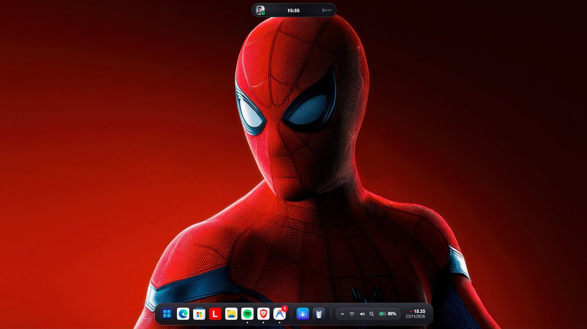

# Wizzly

**macOS-style Dock, Dynamic Island Notch & Spotlight for Windows**

Lightweight desktop companion built with Rust & Tauri — bringing a customizable glass Dock, interactive Notch/Dynamic Island, and instant Spotlight search to Windows.

[Download Latest Release](https://github.com/loganmaxx/wizzly/releases/latest) · [Report a Bug](https://github.com/loganmaxx/wizzly/issues) · [Support Wizzly](#support--donate)

---

  

## Features

### Dock & Desktop Experience
- **Customizable Glass Dock** — Choose between **Frosted**, **Liquid**, **Matte**, and **Classic** glass materials with optional **Wallpaper Tint** and **Dark / Light** themes.
- **Icon Styles & Animations** — Smooth magnification, launch bounce, running indicators, notification badges, window previews, and icon styles (*Windows*, *Squircle*, *macOS Pack*, *Normalized*).
- **Interactive Drag & Drop** — Drag apps from Launchpad to pin, drag icons out to unpin, or drop files directly onto Dock icons to open them.
- **Folders & Stacks** — Pin custom folders, browse your **Downloads Stack** (Grid or List view), and access Trash right from the Dock.
- **Built-in System Panels** — Quick access to Launchpad, Wi-Fi, **Per-App Volume Mixer**, Control Center, Calendar, and System Tray.
- **Multi-Monitor & Smart Auto-Hide** — Target Primary monitor, Follow Cursor, or a specific display, with **Borderless Fullscreen Detection** for gaming and presentations.

### Wizzly Notch (Notch / Dynamic Island)
- **Media & Synced Lyrics** — Now-playing widget with playback controls, seek bar, and live synced lyrics.
- **File Shelf (AirDrop-style Tray)** — Drag files from Explorer onto the Notch to hold them temporarily, then drag them out into browsers, Discord, WhatsApp, etc.
- **Clipboard History** — Search, pin, and quick-paste your recent copied text, links, and images.
- **Focus / Pomodoro Timer** — Built-in timer modes right inside the Notch.
- **Live Alerts & OSD** — Clean toast previews for incoming Windows notifications plus Volume, Wi-Fi, and Bluetooth overlays.

### Spotlight Search
- Press **`Alt + Space`** (fallback: `Ctrl + Alt + Space`) to search and launch apps, run system items, or calculate math expressions inline.

### Localization & Installer
- Available in **English** and **Indonesian** (`Auto`, `EN`, `ID`).
- Lightweight Windows installer (~3.3 MB).

---

## Download & Installation

1. Go to [**Releases**](https://github.com/loganmaxx/wizzly/releases/latest).
2. Download **`Wizzly_0.1.0_x64-setup.exe`**.
3. Run the installer and follow the setup wizard (supports English & Indonesian).

> **Note about Windows SmartScreen**
> Because Wizzly is an independent app without a paid EV code-signing certificate yet, Windows Defender SmartScreen may show *"Windows protected your PC"* on first launch. Click **More info → Run anyway** to proceed.

---

## System Requirements

- **OS:** Windows 10 / Windows 11 (64-bit)
- **Runtime:** Microsoft Edge WebView2 Runtime (already pre-installed on Windows 11 and most Windows 10 systems)

---

## Support & Donate

Wizzly is free to download and use. If you enjoy using it and want to support future updates, you can support the project via:

- **PayPal:** [paypal.me/adrn87](https://paypal.me/adrn87)
- **Binance Pay (UID):** `977044132`
- **QRIS (Indonesia):**

  

---

## Feedback & Support

Found a bug or have an idea for Wizzly?
Open an issue on the [**Issues**](https://github.com/loganmaxx/wizzly/issues) tab!

  Made with ❤️ by Adrian

